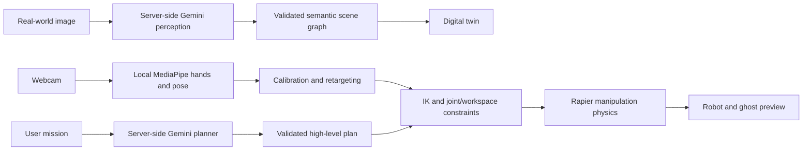

# REALM

## Turn Reality Into a Robotics Playground

**You don't control the robot. You become the robot.**

## What REALM Does

REALM turns a workspace photograph into a semantic robotics environment. Gemini identifies simplified objects and their relationships. Local MediaPipe hand tracking drives a humanoid-inspired robot's arms; constrained inverse kinematics and Rapier physics enable pick, carry, place and drop.

## Problem

Getting started with embodied robotics usually requires hardware, complex setup, or an environment disconnected from the world around you.

## Solution

A photograph becomes the workspace. Your hands become the interface. High-level AI reasoning and deterministic motion meet in one interaction loop.

## Demo

Choose **Explore the demo** on the landing page. The bundled workbench has a bottle, cup and obstacle. In Mission Control choose **AI assist → Load offline demo plan → Execute validated plan** to see the entire manipulation loop without a key. This fixed plan is labeled OFFLINE SCRIPT and is never presented as a Gemini result.

For manual operation: enable the camera, hold an open palm at chest height and click **Calibrate hands**. Move sideways/up/down; moving toward the camera increases forward reach. Pinch thumb and index finger to grasp and separate them to release. Tracking loss freezes targets and keeps a held object secured. Space stops motion; Resume re-enables control. Pointer/keyboard fallback: arrows change X/Y, Q/E changes depth, G toggles the gripper. The base is stationary.

## How It Works

1. Upload a JPEG, PNG or WebP, or take a webcam snapshot.
2. Explicitly analyze that image with the server-side Gemini route.
3. Validated scene JSON becomes primitive geometry and collision volumes.
4. Select a real image bounding box or digital object to highlight its counterpart.
5. Track hands locally, preview the target as a ghost, validate it and move.
6. Close the gripper near an interactable object, carry it, then release into physics.
7. Review measured elapsed time, end-effector path, constraint events and estimated effort.

## System Architecture



## Computer Vision

Two-hand landmarks, handedness scores, pinch hysteresis and body pose run in the browser. Palm-width changes provide a coarse relative depth control. Shoulder/elbow/wrist angles are shown when body landmarks are present. Body pose is used for operator telemetry; hand landmarks drive the arms. Models and WASM are bundled in `public/vision`; no continuous frames go to Gemini. A snapshot leaves the browser only when the user clicks Analyze. Camera requires localhost or HTTPS and user permission. Model initialization uses CPU for portability, with throttled inference.

## Gemini Integration

The official `@google/genai` SDK runs only in `server/handler.ts`, reused by Express and Vercel functions. Routes:

| Route                      | Responsibility                                        |
| -------------------------- | ----------------------------------------------------- |
| POST `/api/analyze-scene`  | Image → schema-constrained scene                      |
| POST `/api/plan-mission`   | Scene, state, constraints and goal → high-level steps |
| POST `/api/explain-action` | Explain an accepted or rejected checkpoint            |
| GET `/api/health`          | Readiness boolean; no credential contents             |

Zod validates both requests and outputs, including cross-references and image bounds. API failures return useful errors without raw provider payloads or credentials. Planning does not authorize low-level motor motion; the local controller rechecks geometry. Input size limits, timeouts and per-instance throttling bound requests. For a public high-traffic deployment configure Vercel Firewall rate limits; the in-memory limiter is not distributed authentication or a global spend cap.

References: [Google structured outputs](https://ai.google.dev/gemini-api/docs/structured-output), [MediaPipe Hand Landmarker](https://developers.google.com/edge/mediapipe/solutions/vision/hand_landmarker/web_js).

## Semantic Digital Twin

Boxes, cylinders and spheres preserve approximate image-relative layout. Estimated dimensions and masses are not measurements. Surface height establishes object support. The photo stays in browser memory; the app does not persist uploads. A demo scene has no source photograph and the UI clearly says so. Successful Gemini scenes expose clickable image regions and matching virtual IDs.

## Human-to-Robot Retargeting

A calibrated wrist neutral point maps screen XY and palm-size depth into a robot-space target. A three-joint arm model solves shoulder yaw, shoulder pitch and elbow flexion analytically. Actual and ghost segments use the same forward kinematics. A ghost turns red if the target cannot be accepted. Pose landmarks provide measured human angles as a secondary readout; this is not full-body motion capture.

## Mechanical Constraints

- Two 0.48 m arm links with a conservative 0.94 m reach envelope.
- Yaw −2.4 to 2.4 rad; pitch −1.3 to 2.4 rad; elbow 0.12 to 2.75 rad.
- End-effector speed cap 0.65 m/s; limited speed ramp and joint acceleration.
- Swept-link checks against support and obstacle boxes, held-proxy bounds, and end-effector separation. Rejected paths hold position. Emergency/tracking-loss stops intentionally brake immediately.
- Grasp requires proximity and an interactable object. Held objects are kinematic; released objects are dynamic Rapier bodies under gravity, with fixed orientation for demo stability.
- Approximate effort = positive gravitational work for nominal 1.2 kg moving mass plus payload, plus 2 J/m path cost. Not electrical consumption or full robot dynamics.
- Collision metric counts **blocked collision attempts**, not physical impact measurements. Efficiency is straight-line object displacement divided by total arm end-effector travel; it is deliberately conservative. Score is a transparent demo heuristic, not a validated robotics benchmark.

## Tech Stack

React 19, Vite, TypeScript, Three.js, React Three Fiber/Drei, Rapier, MediaPipe Tasks Vision, Google GenAI SDK, Tailwind CSS, Framer Motion, Lucide, Express and Vercel functions. Exact installed versions are locked in `package-lock.json`.

## Setup

Install Node.js 22 or newer. Clone this repository, then:

```sh
npm ci
cp .env.example .env
```

PowerShell users can use `Copy-Item .env.example .env` instead. Do not overwrite an existing credential file.

## Gemini API Setup

Edit the local `.env`:

```dotenv
GEMINI_API_KEY=your_local_secret
GEMINI_MODEL=gemini-2.5-flash
```

Never use a `VITE_` prefix for credentials. `.env` is ignored before the first commit. Set a model available to your Google project if the default is unavailable. Restart the API after editing `.env`. Missing, revoked, invalid or exhausted credentials stop only the Gemini operation; the demo remains usable. Project metadata or a key display name cannot authenticate API requests.

## Running Locally

```sh
npm run dev
```

Open `http://127.0.0.1:5173`. Vite proxies `/api` to the server on port 3001.

```sh
npm test
npm run build
```

`npm run preview` previews static production assets; use `npm run dev` for the complete local app and API. The 3D chunk is comparatively large because it includes a physics runtime. MediaPipe assets are served locally and require no CDN at runtime.

## Deployment

Import this public repository into Vercel, using the Vite preset, `npm run build`, and output directory `dist`. Root directory is `.`. The checked-in `vercel.json` configures server functions. Add `GEMINI_API_KEY` in **Project Settings → Environment Variables** for production (and preview if needed), then redeploy. Optionally add `GEMINI_MODEL`. Set account/API quotas and production firewall rate limits before sharing widely. The app is deployable without a key, with live AI features visibly unavailable and the offline demo functional.

## Hacklanta Challenges

Targets supplied by the project brief: Mercedes-Benz — Best Application of Computer Vision; MLH — Best Use of Gemini API; Adobe Creative track. Eligibility and exact 2026 judging rules need confirmation with organizers before submission. This README does not claim those awards or eligibility have been verified.

## Future Work

Calibrated metric depth, multi-surface reconstruction, obstacle-aware trajectory search, full self-collision volumes, dynamic articulated joints, locomotion, rotation-aware grasping, worker-thread vision, and physical robot deployment.

## Team

Arnav Sawant. Built with AI-assisted implementation; review your event's AI disclosure requirements. Add other team members only if they contributed.

## Built at Hacklanta 2026

Prepared for Hacklanta 2026. See `docs/SUBMISSION.md` for Devpost copy, `docs/DEMO_SCRIPT.md` for the 90-second walkthrough, and `docs/VERIFICATION.md` for tested behavior and remaining checks.
